# Ahmed Mohamed

**Software Engineer** | B.A. Computer Science, Luther College (May 2027) | Minors: Mathematics and Data Science

Full-stack and backend engineer. I built ChessMate, a chess coaching platform with 180+ users, and I run it in production on AWS. Experience at Mayo Clinic, Calero, and AImpulse. Looking for new-grad software engineering roles starting mid-2027.

[Email](mailto:ahmedmohamed200354@gmail.com) · [LinkedIn](https://linkedin.com/in/ahmedmohamedh) · [Portfolio](https://ahmedmohamedh.vercel.app/)

---

## About

- **Mayo Clinic:** browser-only DICOM anonymizer, so patient data never reaches a server. 270-tag rules engine, 122 tests proving no network request carries PHI.
- **Calero:** C# and .NET tooling that cut developer setup from 8 hours to 15 minutes, plus an xUnit harness that replays 100+ LLM scenarios on every deploy.
- **AImpulse:** React, Node.js and Dialogflow chatbot on AWS Lambda serving 10,000+ queries a month, and a Python, PostgreSQL and S3 resume-parsing pipeline that cut processing time 30%.
- Competitive chess player: **2150** blitz on [Chess.com](https://www.chess.com/member/AhmeedM1), also on [Lichess](https://lichess.org/@/ahmed56781).

---

## Open Source

10 merged PRs across 5 projects.

| Project | PRs | What I fixed |
| --- | --- | --- |
| [django/django](https://github.com/django/django) | [#21629](https://github.com/django/django/pull/21629) | 9-year-old crash in the parallel test runner. Database clones are now pooled so respawned workers reuse them. |
| [redis/redis-py](https://github.com/redis/redis-py) | [#4206](https://github.com/redis/redis-py/pull/4206), [#4254](https://github.com/redis/redis-py/pull/4254), [#4545](https://github.com/redis/redis-py/pull/4545) | EVALSHA routing in cluster pipelines and an async connection fix. TLS connections with the same settings now share one SSL context, which cut sync memory per connection from about 755 KB to 41 KB. |
| [open-telemetry/opentelemetry-python-contrib](https://github.com/open-telemetry/opentelemetry-python-contrib) | [#4827](https://github.com/open-telemetry/opentelemetry-python-contrib/pull/4827), [#4828](https://github.com/open-telemetry/opentelemetry-python-contrib/pull/4828), [#5063](https://github.com/open-telemetry/opentelemetry-python-contrib/pull/5063) | Celery spans reporting the wrong worker, Redis spans dropping `db=None`, and SQLAlchemy pool usage moved to the current `db.client.connection.count` metric. |
| [matplotlib/matplotlib](https://github.com/matplotlib/matplotlib) | [#32147](https://github.com/matplotlib/matplotlib/pull/32147), [#32380](https://github.com/matplotlib/matplotlib/pull/32380) | Nested-brace parsing in mathtext (backported to 3.11), and `figimage` images vanishing when re-added. |
| [psf/black](https://github.com/psf/black) | [#4611](https://github.com/psf/black/pull/4611) | Release workflow moved to PyPI Trusted Publishing. |

---

## Selected Projects

| Project | Description | Stack |
| --- | --- | --- |
| [**ChessMate**](https://github.com/ahmed5145/ChessMate) | Chess coaching platform in production. Imports games from Chess.com or Lichess, runs Stockfish through an async Celery pipeline, and finds recurring patterns across 5 to 30 games. 180+ users, live Stripe payments, 2,150+ tests gating CI ([Live](https://chess-mate.online)) | Python, Django, React, PostgreSQL, Celery, Redis, AWS |
| [**Fencekit**](https://github.com/ahmed5145/fencekit) | Redis coordination library on PyPI: fencing-token locks and idempotency guards that stop duplicate Celery runs. Extracted from ChessMate ([PyPI](https://pypi.org/project/fencekit/)) | Python, Redis, Celery, Lua, Hypothesis |
| [**ReturnRider**](https://github.com/ahmed5145/ReturnRider) | Return and refund tracker with a NestJS API, Expo mobile app, and Go email worker. AWS staging (VPC, RDS Postgres, ElastiCache Redis, S3) provisioned with Terraform | NestJS, Expo, PostgreSQL, Go, Terraform |
| [**CampusFound**](https://github.com/ahmed5145/CampusFound) | Mobile-first campus lost-and-found with photo uploads and searchable listings ([Demo](https://usecampusfound.vercel.app)) | Next.js, TypeScript, Supabase |
| [**retro_game_engine**](https://github.com/ahmed5145/retro_game_engine) | Python game framework on PyPI with an ECS architecture, CI, docs, and examples ([PyPI](https://pypi.org/project/retro-game-engine/)) | Python, Pygame, Poetry, pytest |

---

## Technical Skills

**Languages:** Python, TypeScript, JavaScript, C#, Go, Java, SQL

**Frameworks:** React, Next.js, Django, Node.js, NestJS, .NET, FastAPI, Celery

**Data & ML:** pandas, scikit-learn, Semantic Kernel, PyTorch

**Databases & Infra:** PostgreSQL, MongoDB, Redis, Docker, AWS, Terraform, OpenTelemetry, Grafana, Git

---

## GitHub Overview

  

  

Contribution snake (updates via GitHub Actions)

<picture>
  <source media="(prefers-color-scheme: dark)" srcset="./assets/github-snake-dark.svg" />
  <source media="(prefers-color-scheme: light)" srcset="./assets/github-snake.svg" />
  
</picture>

